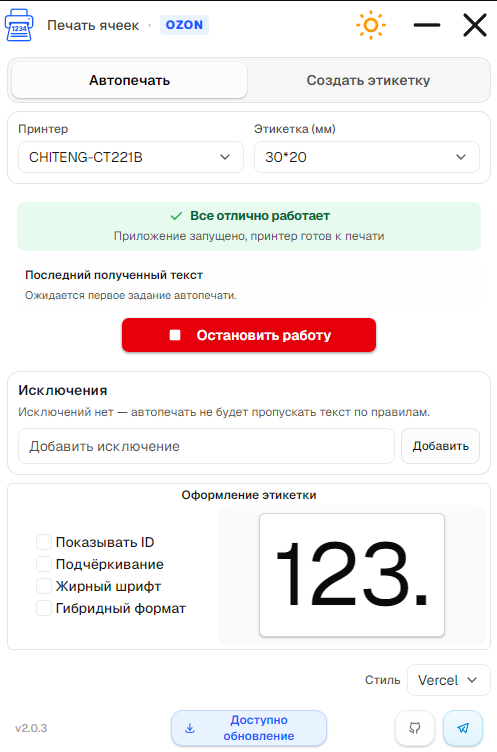
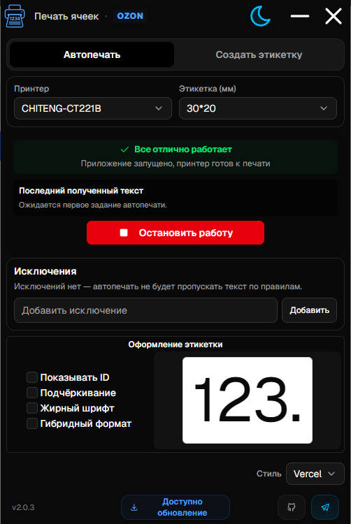
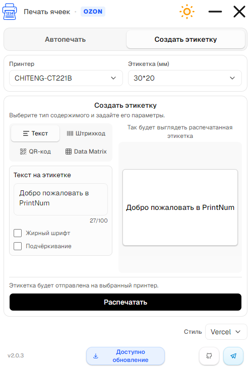
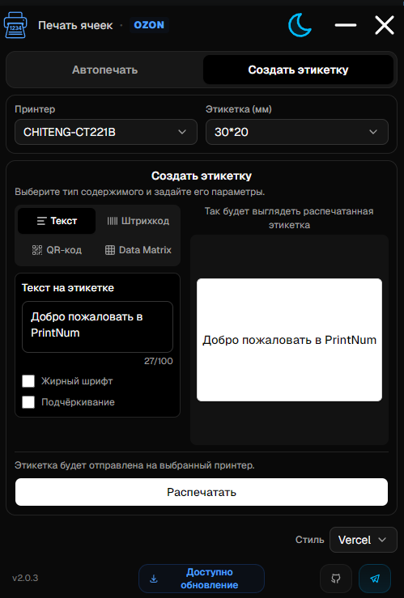

#  PrintNum — Печать ячеек (Ozon)

Бесплатное Windows-приложение для автоматической печати номеров ячеек и складских этикеток Ozon. Программа интегрируется с сайтом Ozon через браузерное расширение и помогает ускорить процессы приемки товаров, выдачи заказов, возвратов, упаковки и работы на складе.

## 📋 Содержание

- [PrintNum — Печать ячеек Ozon](#printnum--печать-ячеек-ozon)
- [🚀 Быстрый старт](#-быстрый-старт)
- [Стек технологий](#стек-технологий)
- [Архитектура](#архитектура)
- [Внешний вид](#внешний-вид)
- [Требования](#требования)
- [Возможности](#возможности)
- [Преимущества](#преимущества)
- [❓ Часто задаваемые вопросы](#-часто-задаваемые-вопросы)
- [API документация](#api-документация)
- [Разработка](#разработка)
- [Сборка и установка](#сборка-и-установка)
- [Структура проекта](#структура-проекта)
- [Помощь](#помощь)

## 🚀 Быстрый старт

[(Вернуться к началу)](#printnum--печать-ячеек-ozon)

1. **Скачайте MSI-установщик**: Перейдите в раздел [**Releases**](https://github.com/kirill18734/PrintNum/releases) и скачайте последнюю версию программы.
2. **Установите приложение**: Запустите MSI и следуйте инструкциям установщика.
3. **Запустите PrintNum**: Откройте приложение из меню «Пуск» или с ярлыка на рабочем столе.
4. **Настройте параметры**:
   - **Принтер** — выберите доступный принтер Windows.
   - **Размер этикетки** — задайте ширину и высоту.
   - **Стиль этикетки** — настройте формат текста и расположение.

5. **Установите расширение для браузера:**
   - Откройте страницу расширения в Chrome Web Store по [ссылке](https://chromewebstore.google.com/detail/printnum-%D0%BF%D0%B5%D1%87%D0%B0%D1%82%D1%8C-%D1%8F%D1%87%D0%B5%D0%B5%D0%BA-ozo/pebpcdibpeodhdkbeniijidffpfpiagn) **или** вручную найдите расширение **«PrintNum - Печать Ячеек (Ozon)»** в Chrome Web Store.
   - Нажмите **«Установить»** и подтвердите установку расширения.

6. **Перезагрузите страницы Ozon**.

7. **Готово!** Теперь расширение **«PrintNum - Печать Ячеек (Ozon)»** автоматически передает номера ячеек в программу PrintNum, запущенную на вашем компьютере.

## Стек технологий

[(Вернуться к началу)](#printnum--печать-ячеек-ozon)

| Компонент     | Технология                                                                                                                               | Описание                      |
| ------------- | ---------------------------------------------------------------------------------------------------------------------------------------- | ----------------------------- |
| **Frontend**  | [React](https://react.dev/) 19 + [TypeScript](https://www.typescriptlang.org/) 5.8 + [Tailwind CSS](https://tailwindcss.com/) 4.3 + Vite | UI приложения                 |
| **Backend**   | [Python](https://www.python.org/) 3.10+ + [Flask](https://flask.palletsprojects.com/) 3.1 + [pywin32](https://github.com/pywin/pywin32)  | API для печати и конфигурации |
| **Desktop**   | [Tauri](https://tauri.app/) 2 (Rust 2021)                                                                                                | Десктопная оболочка Windows   |
| **Extension** | [WXT](https://wxt.dev/) + React 18 + TypeScript                                                                                          | Браузерное расширение Ozon    |

## Архитектура

[(Вернуться к началу)](#printnum--печать-ячеек-ozon)

Проект использует модульную архитектуру для разделения ответственности между четырьмя основными компонентами:

### 🎨 **Frontend (React)**

- Управляет пользовательским интерфейсом и настройками приложения.
- Коммуницирует с backend через HTTP-запросы.
- Отвечает за темы, стили этикеток и сохранение конфигурации.

### 🔧 **Backend (Flask + Python)**

- Запускает REST API сервер для обработки запросов на печать.
- Читает конфигурацию.
- Проверяет состояние принтера и отправляет текст на печать.
- Завершается автоматически после 10 секунд неактивности.

### 📱 **Desktop (Tauri + Rust)**

- Обеспечивает нативную оболочку приложения для Windows.
- Запускает backend-процесс при старте.
- Поддерживает автообновления и системные диалоги.

### 🌐 **Браузерное расширение (WXT + React + TypeScript)**

- Работает на страницах Ozon и отправляет номера ячеек в программу PrintNum на ПК.
- Автоматизирует процессы выдачи, приемку, возврат товаров и упаковку.
- Скрывает элементы интерфейса и управляет поведением страницы.

```
┌─────────────┐
│ Пользователь│
└──────┬──────┘
       │
       │ работает с
       ▼
┌─────────────┐
│ Ozon        │
│ сайт        │
└──────┬──────┘
       │
       │ данные о ячейке
       ▼
┌─────────────────┐
│ PrintNum        │
│ Extension       │
│                 │
│ Content Script  │
└───────┬─────────┘
        │
        │ HTTP / fetch
        │ localhost:5000
        ▼
┌─────────────────┐
│ Flask Backend   │
│                 │
│ принимает номер │
│ ячейки           │
└───────┬─────────┘
        │
        │ Windows API
        ▼
┌─────────────────┐
│ Windows Printer │
└───────┬─────────┘
        │
        ▼
   📄 Этикетка
   с номером ячейки
```

## Внешний вид

[(Вернуться к началу)](#printnum--печать-ячеек-ozon)

Главное окно имеет фиксированный размер **500 × 800 логических пикселей**: содержимое не изменяет размер окна, ручное изменение и разворачивание отключены. Прокручивается только рабочая область между верхней и нижней панелями.

Печать представлена вертикальными этапами: полученный текст → запуск → исключения → оформление → результат. Для переименованных заданий перед оформлением появляется дополнительный этап, например **«Ozon Полка - 15 → П-15»**. Зелёная отметка подтверждает выполненный этап, янтарная — пропуск или остановку, красная — ошибку. Проверка исключений на сервере по-прежнему предшествует проверке принтера: для пропущенного текста готовность принтера может остаться неподтверждённой. Отправка задания не является подтверждением физической печати.

В разделе **«Оформление»** доступны вкладки **«Автопечать»** и **«Создать этикетку»**. Предпросмотр расположен по центру, настройки — по обе стороны (при узкой области — под превью). После успешной проверки задания автоматическое превью показывает обработанный текст с текущими настройками ID, подчёркивания, жирного шрифта и гибридного формата. Для Ozon полки используется итоговое имя «П-15» без точки. До прохождения проверок отображается ожидание, а не вымышленные данные. Переключение вкладок не отключает автопечать; содержимое ручной этикетки и настройки сохраняются при переключении.

Общий этап **«Результат»** показывает состояние последнего начатого задания независимо от режима, с указанием источника и текста. Повторное получение старого статуса автопечати не заменяет результат более новой ручной отправки. Успех ручной печати подсвечивает зелёным и оформление в режиме создания, и общий результат. Если принтер недоступен или не выбран, весь этап запуска становится красным, подсветка остальных этапов сбрасывается; в режиме создания этап оформления также красный. Исторический результат при этом сохраняется с нейтральной подсветкой.

<table>
  <thead>
    <tr>
      <th>Светлая тема</th>
      <th>Тёмная тема</th>
    </tr>
  </thead>
  <tbody>
    <tr>
      <td colspan="2" style="font-weight: bold; text-align: center;">Главная страница</td>
    </tr>
    <tr>
      <td></td>
      <td></td>
    </tr>
    <tr>
      <td colspan="2" style="font-weight: bold; text-align: center;">Создание этикетки</td>
    </tr>
    <tr>
      <td></td>
      <td></td>
    </tr>
  </tbody>
</table>

## Требования

[(Вернуться к началу)](#printnum--печать-ячеек-ozon)

- **ОС**: Windows 10+ x64 — требуется для работы печати и Tauri
- **Браузер**: Chromium-совместимый браузер (Chrome, Yandex, Edge).
- **Python**: 3.10+ для backend-разработки.
- **Node.js**: 18+ LTS для frontend, extension и Tauri.
- **Rust**: 1.70+ для сборки Tauri-приложения.
- **Python-зависимости**: Flask, flask-cors, pywin32.

## Возможности

[(Вернуться к началу)](#printnum--печать-ячеек-ozon)

### Возможности приложения

- 🖨️ **Автоматическая печать номеров ячеек Ozon** без ручного ввода.
- 📋 **Поддержка складских этикеток и маркировки** для ускорения работы сотрудников.
- 🖨️ **Выбор принтера** — автоматическое обнаружение подключённых принтеров Windows.
- 📏 **Гибкая настройка этикеток** — изменение размеров, шрифтов и расположения текста.
- 🔤 **Форматирование текста** — добавление ID, подчёркивания и гибридных режимов отображения.
- 🎨 **Персонализация интерфейса** — настройка внешнего вида и шаблонов печати.
- 🌙 **Светлая и тёмная темы** для комфортной работы.
- 🔄 **Автоматические обновления** через Tauri.
- 💾 **Сохранение настроек** между запусками приложения.
- ⚡ **Интеграция с браузером** для мгновенной отправки данных на печать.

### Возможности расширения

см. [Документация расширения](https://github.com/kirill18734/PrintNum/tree/main/extension)

## Преимущества

[(Вернуться к началу)](#printnum--печать-ячеек-ozon)

- Экономия времени при работе со складскими ячейками Ozon.
- Снижение количества ошибок при ручном вводе номеров.
- Быстрая настройка и запуск на Windows.
- Удобная интеграция с рабочими процессами склада и ПВЗ.
- Бесплатное использование без сложной настройки.

## ❓ Часто задаваемые вопросы

[(Вернуться к началу)](#printnum--печать-ячеек-ozon)

### Какие браузеры поддерживаются?

PrintNum работает с Chromium-браузерами: **Google Chrome**, **Яндекс Браузер** и **Microsoft Edge**.

### Нужно ли устанавливать расширение?

**Да.** Для работы PrintNum необходимо установить браузерное расширение **«PrintNum — Печать Ячеек (Ozon)»**.

Откройте **Интернет-магазин Chrome**, найдите расширение **«PrintNum — Печать Ячеек (Ozon)»** и нажмите **«Установить»**. После установки перезагрузите страницы Ozon, если они были открыты.

### Как понять, что программа готова к работе?

Запустите PrintNum, выберите принтер и убедитесь, что он отображается в настройках приложения. После этого откройте страницу Ozon и попробуйте отправить номер ячейки на печать.

### Почему номер ячейки не печатается?

Проверьте следующие моменты:

- приложение PrintNum запущено;
- браузерное расширение установлено и включено;
- открытая страница Ozon была обновлена после установки расширения;
- выбран корректный принтер;
- принтер подключен и находится в состоянии «Готов».

### Почему этикетка печатается пустой или текст расположен не по центру?

Если в настройках PrintNum размер этикетки указан правильно, но принтер печатает пустую этикетку, обрезает текст или смещает его относительно центра, то, скорее всего, в настройках самого принтера установлен другой размер бумаги.

Откройте **Настройки принтера** в Windows и вручную установите тот же размер этикетки, который указан в PrintNum. Ширина и высота этикетки в приложении и в драйвере принтера должны полностью совпадать.

После изменения настроек рекомендуется выполнить пробную печать. В большинстве случаев это устраняет проблемы с пустой печатью, смещением текста и неправильным позиционированием этикетки.

### Какие принтеры поддерживаются?

PrintNum поддерживает любые принтеры, доступные в Windows. Наиболее удобно использовать термопринтеры для печати небольших этикеток, однако приложение совместимо и с другими моделями принтеров.

### Можно ли изменить размер и оформление этикетки?

Да. В настройках приложения можно изменить размеры этикетки, шрифт, формат отображения текста и другие параметры печати.

### Где сохраняются настройки?

Все выбранные параметры (принтер, размеры этикетки, стиль печати и другие настройки) автоматически сохраняются и восстанавливаются при следующем запуске приложения.

### Требуется ли постоянное подключение к Интернету?

Интернет необходим только для работы с сайтом Ozon. Обмен данными между браузерным расширением и приложением PrintNum происходит локально на вашем компьютере.

### Как обновить PrintNum?

PrintNum автоматически проверяет наличие новых версий. Если обновление доступно, в приложении появится кнопка **«Обновить»**. После нажатия новая версия будет автоматически загружена и установлена.

### Приложение бесплатное?

Да. PrintNum распространяется бесплатно и предназначено для автоматизации печати номеров складских ячеек и этикеток Ozon.

## API документация

[(Вернуться к началу)](#printnum--печать-ячеек-ozon)

Backend предоставляет REST API на Flask на порту `5000`.

| Метод    | Эндпоинт             | Описание                                   | Ответ                                       |
| -------- | -------------------- | ------------------------------------------ | ------------------------------------------- |
| **GET**  | `/`                  | Проверка доступности сервера               | `{"status": true}`                         |
| **GET**  | `/status-printer`    | Проверка состояния принтера                | `{"printerOnline": true/false}`            |
| **GET**  | `/listPrinters`      | Получение списка принтеров                 | `{"listPrinters": ["Принтер1"]}`           |
| **GET**  | `/auto-print-status` | Статус последнего события автопечати       | `{"event": {...}}`                         |
| **POST** | `/print-number`      | Печать номера ячейки (автопечать)          | `OK`                                         |
| **POST** | `/ozon-shelf`        | Печать по данным полки Ozon (автопечать)   | `OK` или `{"status":"skipped","rule":"..."}` |
| **POST** | `/print-label`       | Печать пользовательской этикетки вручную  | `{"status":"printed"}`                    |

**Базовый URL**: `http://127.0.0.1:5000`

**Автозавершение**: сервер автоматически завершается через 10 секунд неактивности (watchdog).

## Разработка

[(Вернуться к началу)](#printnum--печать-ячеек-ozon)

1. **Клонируйте репозиторий**:

   ```bash
   git clone https://github.com/kirill18734/PrintNum.git
   cd PrintNum
   ```

2. **Настройте backend**:
   - Установите Python 3.10+ с [python.org](https://www.python.org/) (добавьте в PATH).
   - Перейдите в папку `backend`:
     ```bash
     cd backend
     ```
   - Создайте виртуальное окружение:
     ```bash
     python -m venv .venv
     .venv\Scripts\activate  # Windows
     ```
   - Установите зависимости:
     ```bash
     pip install -r requirements.txt
     ```
   - Запустите сервер:
     ```bash
     python backend.py
     ```
   - Сервер запустится на `http://localhost:5000`

3. **Настройте frontend** (в корне проекта):
   - Убедитесь, что Node.js 18+ установлен.
   - Установите зависимости:
     ```bash
     npm install
     ```
   - Запустите dev-сервер Vite:
     ```bash
     npm run dev
     ```
   - Frontend откроется на `http://localhost:5173`

4. **Запустите Tauri** (нативное приложение):
   - Установите prerequisites для вашей ОС: [tauri.app/start/prerequisites](https://tauri.app/start/prerequisites/)
   - В корне проекта запустите:
     ```bash
     npm run tauri dev
     ```
   - Откроется окно приложения с HMR (hot-reload)

5. **Тестируйте расширение**:
   см. [Документация расширения](https://github.com/kirill18734/PrintNum/tree/main/extension)

Проверка отображения этапов и разбора статусов backend (Node.js 22.18+ или 24+, без дополнительных зависимостей):

```powershell
node --test tests\auto-print-pipeline.test.mjs tests\print-workflow.test.mjs
```

## Сборка и установка

[(Вернуться к началу)](#printnum--печать-ячеек-ozon)

- **Backend в EXE**: Используйте [auto-py-to-exe](https://github.com/brentyi/auto-py-to-exe):
  1. Запустите из папки `backend/` и укажите `backend.py` как основной скрипт.
  2. Добавьте в "Additional files" директорию `app/` целиком (все подмодули API/сервисов).
  3. Режим сборки: onefile; Console: windowed; имя бинарника: `backend`.
  4. Сохраните файл как `backend/output/backend(.exe)` — путь совпадает с `externalBin` в Tauri (`src-tauri/tauri.conf.json`).
- **Полная сборка приложения**:

  ```bash
  npm run build       # Сборка frontend
  npm run tauri build # Сборка Tauri (создаст MSI)
  ```

  MSI-инсталлятор будет в `src-tauri/target/release/bundle/nsis/`

- **Установка через MSI**: Запустите `.msi` файл. Приложение установится с расширением и backend'ом.

## Структура проекта

[(Вернуться к началу)](#printnum--печать-ячеек-ozon)

```
PrintNum/
├── backend/                      # Flask-бэкенд и упаковка sidecar
│   ├── backend.py               # Точка входа (HTTP-сервер + idle-watchdog)
│   ├── requirements.txt         # Зависимости Python
│   ├── app/
│   │   ├── api/                 # Маршруты: health, printers, auto_print, labels, lifecycle
│   │   ├── domain/              # Модели и валидация данных
│   │   ├── infrastructure/      # Адаптеры Windows-принтера, конфигурация, активность
│   │   ├── services/            # Бизнес-логика печати и автопечати
│   │   └── factory.py           # Инициализация Flask-приложения
│   ├── get.http                 # Примеры GET-запросов
│   ├── post.http                # Примеры POST-запросов
│   └── output/                  # Скомпилированный EXE: backend(.exe)
├── extension/                   # Браузерное расширение (WXT + React 18)
│   ├── package.json
│   └── src/ ...
├── public/                      # Статические ассеты приложения
│   ├── favicon.ico
│   ├── light/ (home-1280x800.png, create_label-1280x800.png)
│   └── dark/  (home-1280x800.png, create_label-1280x800.png)
├── src/                         # React 19 интерфейс Tauri-приложения
│   ├── index.tsx, layout.tsx
│   ├── pages/
│   │   └── home/ (CreateLabelPanel.tsx, PrinterSettings.tsx, ...)
│   └── services/ (app.tauri.ts, store.ts, ...)
├── src-tauri/                   # Tauri 2 (Rust)
│   ├── Cargo.toml, tauri.conf.json
│   └── src/ (main.rs, lib.rs)
├── package.json                 # Скрипты сборки Vite/Tauri
├── vite.config.ts               # Конфиг Vite 7
└── README.md
```

## Помощь

[(Вернуться к началу)](#printnum--печать-ячеек-ozon)

- **Telegram:** [@printnum](https://t.me/printnum) — официальный канал PrintNum, где можно получить помощь и следить за обновлениями.
