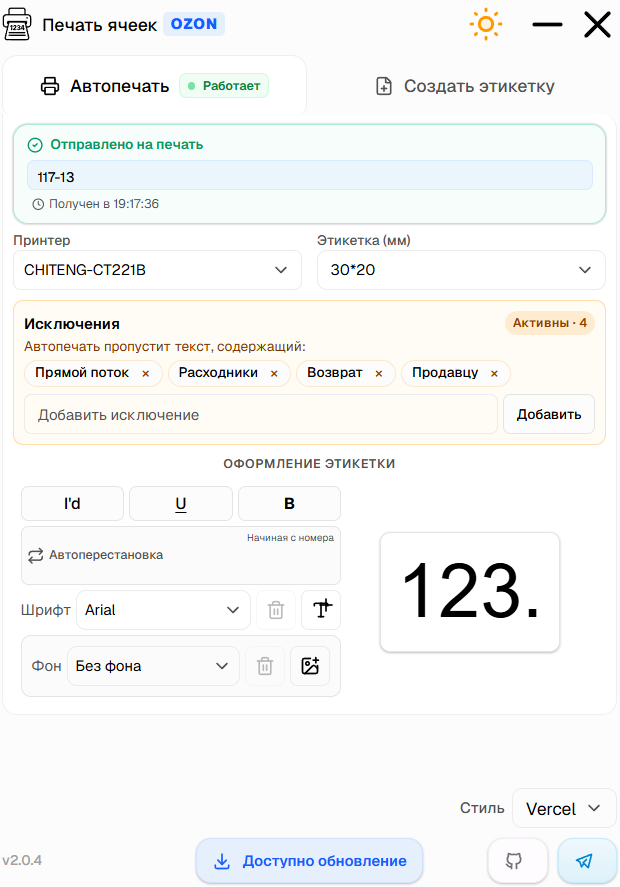
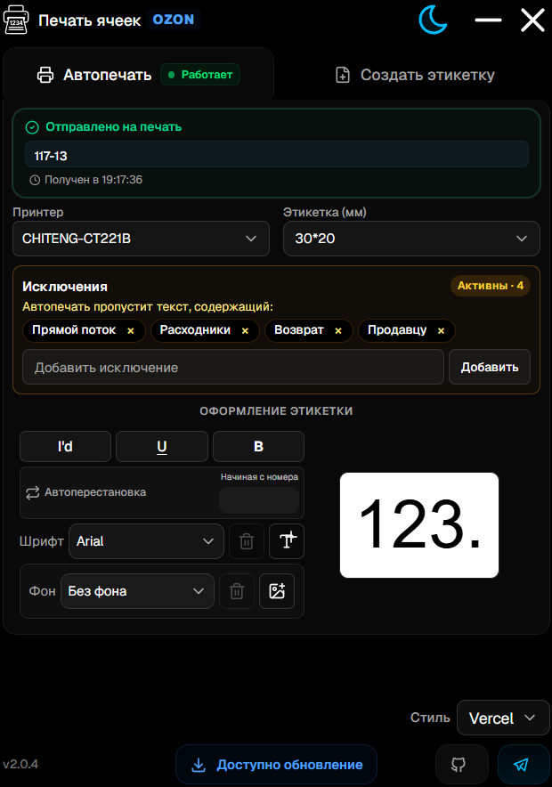
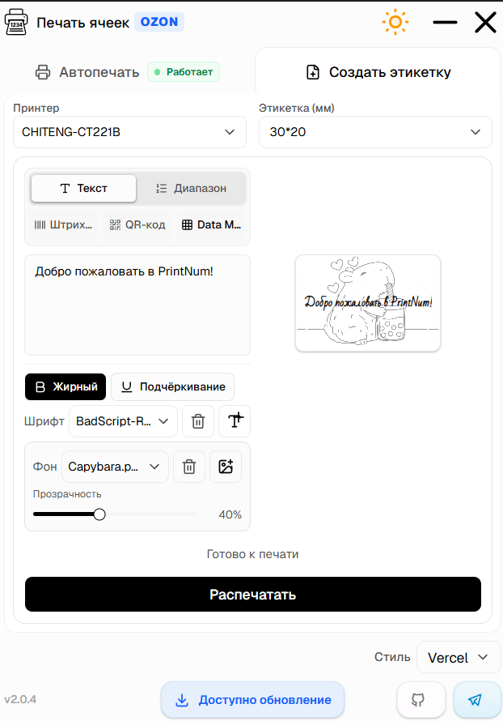
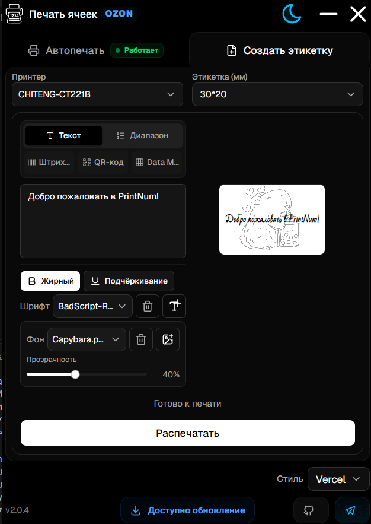

#  PrintNum — Печать ячеек Ozon

**PrintNum** — бесплатное приложение для Windows, которое помогает автоматизировать печать номеров складских ячеек и этикеток. Оно работает вместе с браузерным расширением и подходит для повседневных задач сотрудников пунктов выдачи и складов.

## 📋 Содержание

- [Быстрый старт](#-быстрый-старт)
- [Возможности](#возможности)
- [Внешний вид](#внешний-вид)
- [Настройка приложения](#настройка-приложения)
- [Преимущества](#преимущества)
- [Часто задаваемые вопросы](#-часто-задаваемые-вопросы)
- [Помощь и обратная связь](#помощь-и-обратная-связь)

## 🚀 Быстрый старт

[(Вернуться к началу)](#printnum--печать-ячеек-ozon)

1. **Скачайте MSI-установщик**: Перейдите в раздел [**Releases**](https://github.com/kirill18734/PrintNum/releases) и скачайте последнюю версию программы.
2. **Установите приложение**: Запустите MSI и следуйте инструкциям установщика.
3. **Запустите PrintNum**: Откройте приложение из меню «Пуск» или с ярлыка на рабочем столе.
4. **Настройте параметры**:
   - **Принтер** — выберите доступный принтер Windows.
   - **Размер этикетки** — задайте ширину и высоту.
   - **Оформление этикетки** — настройте формат текста и расположение.
5. **Установите расширение для браузера:**
   - Откройте страницу расширения в Chrome Web Store по [ссылке](https://chromewebstore.google.com/detail/printnum-%D0%BF%D0%B5%D1%87%D0%B0%D1%82%D1%8C-%D1%8F%D1%87%D0%B5%D0%B5%D0%BA-ozo/pebpcdibpeodhdkbeniijidffpfpiagn) **или** вручную найдите расширение **«PrintNum - Печать Ячеек (Ozon)»** в Chrome Web Store.
   - Нажмите **«Установить»** и подтвердите установку расширения.

6. **Готово!** Теперь расширение **«PrintNum - Печать Ячеек (Ozon)»** автоматически передает номера ячеек в программу PrintNum, запущенную на вашем компьютере.

## Возможности

[(Вернуться к началу)](#printnum--печать-ячеек-ozon)

- **Автоматическая печать номеров ячеек Ozon.** Расширение передает номера из браузера в приложение PrintNum.
- **Печать этикеток полок Ozon.** Можно отправлять на печать этикетки для организации хранения.
- **Создание собственных этикеток.** Подготовьте этикетку с нужным содержимым прямо в приложении.
- **Разные типы содержимого.** Добавляйте обычный текст, QR-коды, штрихкоды и Data Matrix.
- **Настройка внешнего вида.** Выбирайте шрифты, меняйте расположение и оформление текста.
- **Собственные фоны.** Добавляйте изображения и используйте их в оформлении этикеток.
- **История и статусы печати.** Просматривайте недавние задания автоматической печати и их состояние.
- **Светлая и тёмная темы.** Выберите оформление интерфейса, которое вам удобнее.

## Внешний вид

[(Вернуться к началу)](#printnum--печать-ячеек-ozon)

В приложении доступны светлая и тёмная темы.

<table>
  <thead>
    <tr>
      <th>Светлая тема</th>
      <th>Тёмная тема</th>
    </tr>
  </thead>
  <tbody>
    <tr>
      <td colspan="2" style="font-weight: bold; text-align: center;">Главная страница</td>
    </tr>
    <tr>
      <td></td>
      <td></td>
    </tr>
    <tr>
      <td colspan="2" style="font-weight: bold; text-align: center;">Создание этикетки</td>
    </tr>
    <tr>
      <td></td>
      <td></td>
    </tr>
  </tbody>
</table>

## Настройка приложения

[(Вернуться к началу)](#printnum--печать-ячеек-ozon)

Перед началом работы откройте настройки PrintNum:

1. **Выберите принтер.** Укажите принтер, на котором будут печататься этикетки.
2. **Укажите размер этикетки.** Задайте ширину и высоту в соответствии с используемой бумагой.
3. **Настройте оформление.** При необходимости измените шрифт, размер и расположение текста.
4. **Добавьте оформление.** Вы можете добавить собственные изображения для фона и выбрать доступные шрифты.
5. **Проверьте готовность принтера.** Убедитесь, что принтер подключён, включён и готов к печати.

Важно: размер бумаги в настройках PrintNum должен совпадать с размером, установленным в драйвере принтера Windows.

## Преимущества

[(Вернуться к началу)](#printnum--печать-ячеек-ozon)

- Меньше ручного ввода и повторяющихся действий.
- Быстрее печать номеров ячеек и складских этикеток.
- Возможность создавать этикетки под свои задачи.
- Настраиваемое оформление и поддержка собственных изображений.
- Простой интерфейс и бесплатное использование.

## ❓ Часто задаваемые вопросы

[(Вернуться к началу)](#printnum--печать-ячеек-ozon)

### Какие браузеры поддерживаются?

Расширение PrintNum предназначено для браузеров на базе Chromium, например **Google Chrome**, **Яндекс Браузера** и **Microsoft Edge**.

### Нужно ли устанавливать браузерное расширение?

**Да.** Для автоматической передачи номеров ячеек с сайта Ozon необходимо установить расширение PrintNum из Chrome Web Store. Ссылка есть в разделе [«Быстрый старт»](#-быстрый-старт).

### Почему номер ячейки не печатается?

Проверьте по порядку:

- приложение PrintNum запущено;
- расширение PrintNum установлено и включено в браузере;
- страница Ozon обновлена после установки расширения;
- в приложении выбран нужный принтер;
- принтер включён, подключён к компьютеру и готов к работе.

### Почему этикетка печатается пустой или текст смещён?

Проверьте размер бумаги в двух местах: в PrintNum и в настройках драйвера принтера Windows. Ширина и высота должны совпадать. После изменения настроек попробуйте напечатать этикетку ещё раз.

### Какие принтеры можно использовать?

Можно выбрать принтер, который установлен в Windows и доступен для печати. Для этикеток удобно использовать термопринтер. Совместимость и доступные размеры бумаги зависят от модели принтера и установленного драйвера.

### Можно ли изменить размер и оформление этикетки?

Да. В приложении можно настроить размер этикетки, оформление текста, шрифты и фон.

### Можно ли добавить собственное изображение или шрифт?

Да. В приложении предусмотрено добавление изображений для оформления этикеток. Также можно использовать доступные в PrintNum шрифты.

### Нужно ли постоянно подключение к Интернету?

Интернет нужен для работы с сайтом Ozon и загрузки обновлений. Передача данных между браузерным расширением и приложением выполняется локально на компьютере.

### Как обновить PrintNum?

Если в приложении доступно обновление, воспользуйтесь появившейся кнопкой **«Обновить»**. Также актуальную версию можно скачать в разделе [Releases](https://github.com/kirill18734/PrintNum/releases).

### Приложение бесплатное?

Да, PrintNum распространяется бесплатно.

## Помощь и обратная связь

[(Вернуться к началу)](#printnum--печать-ячеек-ozon)

- **Telegram:** [общий чат PrintNum](https://t.me/printnum) — задавайте вопросы, сообщайте о проблемах и делитесь предложениями.
- **Новый сервис:** хотите добавить поддержку своего сервиса или площадки в PrintNum? Напишите об этом в [общий Telegram-чат](https://t.me/printnum). Расскажите, какой сервис вы используете и для каких задач нужна интеграция. Мы рассмотрим ваше предложение.
- **Обновления:** новые версии приложения доступны в разделе [GitHub Releases](https://github.com/kirill18734/PrintNum/releases).
