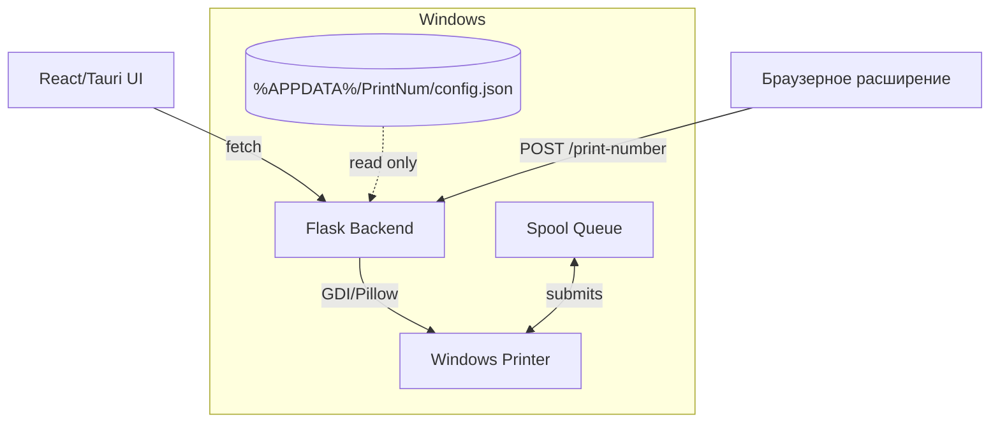

# Backend PrintNum

Локальный HTTP‑сервис для печати этикеток и автопечати номеров под Windows. Backend принимает команды от интерфейса Tauri и (опционально) от браузерного расширения, валидирует данные, учитывает пользовательские настройки и отправляет задания в очередь принтера Windows.

## Содержание

- [Кратко](#кратко)
- [Архитектура](#архитектура)
- [Структура каталогов](#структура-каталогов)
- [Требования](#требования)
- [Установка зависимостей](#установка-зависимостей)
- [Конфигурация](#конфигурация)
- [Запуск и остановка](#запуск-и-остановка)
- [HTTP API](#http-api)
- [Ошибки и ограничения](#ошибки-и-ограничения)
- [Жизненный цикл процесса](#жизненный-цикл-процесса)
- [Тестирование](#тестирование)
- [Сборка backend.exe для Tauri](#сборка-backendexe-для-tauri)
- [Диагностика](#диагностика)

## Кратко

- Только локальный доступ: сервер слушает `127.0.0.1:5000` и недоступен из сети.
- Очередь принтера очищается только от заданий с префиксом документа `PrintNum:` — чужие задания не трогаются.
- Лимит размера HTTP‑запроса — $6\,\text{МБ}$; изображение кода в PNG — до $4\,\text{МБ}$.
- Настройки читаются из общего для приложения конфигурационного файла и кэшируются по времени изменения.

## Архитектура



Слои и ответственность:

- API (app/api/*) — маршруты Flask, валидация входа и формирование ответов.
- Сервисы (app/services/*) — сценарии автопечати и ручной печати, сериализация доступа к принтеру.
- Домен (app/domain/*) — правила форматирования/валидации, ограничения полезной нагрузки.
- Инфраструктура (app/infrastructure/*) — репозиторий настроек, жизненный цикл, адаптер Windows (Spooler, GDI, Pillow).

Зависимости инъецируются в `create_app`, что упрощает модульное и интеграционное тестирование (подмена принтера и/или репозитория настроек).

## Структура каталогов

```text
backend/
  app/
    api/              HTTP-маршруты: здоровье, принтеры, автопечать, этикетки, остановка
    domain/           Валидация запросов, правила исключений, макет этикетки
    infrastructure/   Репозиторий настроек, жизненный цикл, адаптеры Windows
    services/         Сериализация печати, сценарии автопечати/ручной печати
    factory.py        Сборка приложения и регистрация маршрутов
  backend.py          Точка входа (локальный HTTP‑сервер)
  requirements.txt    Зависимости Python (Flask, CORS, pywin32, Pillow)
  test_*.py           Модульные/интеграционные тесты
```

Ключевые файлы отправки в печать: `app/infrastructure/windows_rendering.py` (GDI/Pillow) и `app/infrastructure/windows_printer.py` (Spooler API). Префикс документов — `app/infrastructure/print_job.py`.

## Требования

- ОС: Windows 10/11 (для работы с принтером через Win32 API).
- Python 3.10+ (рекомендуется) и зависимости из `requirements.txt`.
- Установленный и настроенный принтер Windows.

## Установка зависимостей

Из корня репозитория:

```powershell
# Установить зависимости бэкенда
python -m pip install -r backend/requirements.txt
```

Зависимости `pywin32` и `Pillow.ImageWin` специфичны для Windows: HTTP‑часть и большинство тестов могут выполняться на других ОС, но фактическая печать — только в Windows.

## Конфигурация

Путь к конфигурации (совместно с Tauri‑приложением):

- `%APPDATA%\PrintNum\config.json`
- Фолбэк при отсутствии `APPDATA`: папка `backend/PrintNum` рядом с исходниками.

Файл создаётся/обновляется интерфейсом; backend его только читает (возвращается копия, данные кэшируются по времени изменения).

Ключи:

| Ключ | Назначение |
| --- | --- |
| `printer` | Имя выбранного принтера Windows |
| `excludedTexts` | Список фраз‑исключений для автопечати (без учёта регистра) |
| `paper` | Размер этикетки, мм: `ширина*высота` (например, `30*20`) |
| `idNum` | Печатать дополнительную часть номера |
| `endLine` | Подчёркивание вместо завершающей точки |
| `hybrid` | Гибридное форматирование номера |
| `expand` | Порог для гибридного форматирования |

## Запуск и остановка

Запуск из корня репозитория:

```powershell
python backend/backend.py
```

Или из папки `backend`:

```powershell
python backend.py
```

- Сервер слушает только `127.0.0.1:5000`.
- Тайм‑аут простоя по умолчанию — 10 секунд (переопределяется через `run_server(idle_timeout=...)`).
- При запуске через Tauri backend стартует как sidecar‑процесс; при наличии уже запущенного экземпляра Tauri повторно его не запускает (предварительно запрашивает `GET /`).
- Остановка — `POST /shutdown` (см. безопасность ниже).

Для автономной работы без постоянных запросов от интерфейса используйте флаг `--standalone`:

```powershell
python backend.py --standalone
```

Для собранного приложения тот же флаг передаётся исполняемому файлу:

```powershell
.\backend.exe --standalone
```

В этом режиме:
- Завершение по тайм-ауту простоя отключено; `POST /shutdown` продолжает работать.
- Перед каждой отправкой на печать через `/print-number`, `/ozon-shelf` и `/print-label` проверяется текущая готовность выбранного принтера, независимо от кэша и запросов `/status-printer`.
- Результат проверки обновляет кэш. При недоступности принтера или ошибке проверки задание не отправляется; форматы ответов API остаются прежними.
- Запросы, отклонённые до печати (невалидные данные, исключения, выключенная автопечать, отсутствие выбранного принтера), не вызывают проверку статуса.

Без флага сохраняются тайм-аут простоя и использование кэшированного статуса. Программно режим включается через `run_server(standalone=True)` или `create_app(standalone=True)`; он отключает тайм-аут независимо от значения `idle_timeout`. Настройки (исключения и выбранный принтер) по-прежнему читаются из конфигурации.

## HTTP API

База: `http://127.0.0.1:5000`. Для JSON используйте заголовок `Content-Type: application/json`.

### GET /

Проверка доступности backend.

```json
{"status": true}
```

### GET /listPrinters

Список локальных и подключённых принтеров.

```json
{"listPrinters": ["Имя принтера"]}
```

### GET /status-printer

Проверка готовности выбранного принтера.

```json
{"printerOnline": true}
```

### POST /print-number

Запрос автопечати номера/текста:

```json
{"text": "500-1"}
```

Возможные ответы:
- 200 OK — задание отправлено; либо пропущено по исключению
  (`{"status":"skipped","rule":"<имя правила>"}`).
- 400 — некорректный запрос (`error`).
- 500 — внутренняя ошибка печати (`error`).

Формат зависит от `idNum`, `endLine`, `hybrid`, `expand`. Список `excludedTexts` проверяется без учёта регистра.

### POST /ozon-shelf

Преобразование текста полки Ozon в формат печати, далее как `/print-number`:

```json
{"text": "Ozon Полка - 1"}
```

### GET /auto-print-status

Статус последнего задания автопечати (или `{"event": null}` до первого запроса).

Событие содержит `id`, `text`, `receivedAt` (Unix-время в миллисекундах), `status` и `steps`.
Статус события: `processing`, `printed`, `ignored`, `skipped` или `error`.
Шаги сохраняют поля `status` и `message`; дополнительное необязательное поле `stage` позволяет группировать их без разбора текста:

- `received` — получение текста и переименование (например, `Переименовано в П-123`).
- `readiness` — подтверждённая доступность принтера либо блокировка: автопечать выключена, принтер не выбран или недоступен.
- `exclusions` — исключений нет (`complete`) или найдено исключение (`skipped`).
- `formatting` — `complete` только после успешного возврата `print_number`: форматирование выполняется внутри адаптера. При ошибке вызова этот этап не подтверждается.
- `result` — обработка (`pending`), отправка на печать (`complete`), блокировка (`blocked`), пропуск (`skipped`) или ошибка (`error`). Отправка не подтверждает физическое завершение печати.

Порядок шагов отражает реальные проверки: включение автопечати, исключения, затем принтер. Для вертикального отображения можно группировать этапы как `received`, `readiness`, `exclusions`, `formatting`, `result`; отсутствующий этап не означает успех. Например, при исключении принтер не проверяется. Пустой текст даёт `ignored` с результатом `skipped`.

Во время обработки опрос возвращает уже подтверждённые шаги и ожидающий результат; начальный `pending` относится к `result`, а не к готовности. При исключении Python подтверждения сохраняются, результат становится `error`. Обновления старого задания не заменяют более новое событие.

Программно `AutoPrintService.process(text, print_text=None, on_progress=None)` принимает необязательный синхронный callback `on_progress(steps)`. Он получает независимый снимок накопленных шагов после каждого добавления. Исключения обработки продолжают передаваться вызывающему коду; HTTP-маршруты сохраняют прогресс через `AutoPrintStatus.progress(event_id, steps)` и завершают событие через `finish`/`fail`. POST-ответы не изменены: `OK`, JSON пропуска с правилом или прежний ответ ошибки.

### POST /print-label

Ручная печать этикетки.

```json
{
  "contentType": "text",
  "content": "Заказ № 12345",
  "bold": false,
  "underline": false,
  "showCodeText": false
}
```

`contentType`: `text | barcode | qr | datamatrix`. Для кодов требуется `codeImage` (PNG в Base64, до 4 МБ). `content` — непустая строка до 4096 символов.

Успех: `{"status":"printed"}`.

## Ошибки и ограничения

- Лимит тела запроса: $6\,\text{МБ}$ (настраивается в `factory.py`). Из них до $4\,\text{МБ}$ может занимать изображение кода.
- Коды ответов:
  - 400 — ошибка валидации данных (тип, размер, формат PNG и т. п.).
  - 409 — принтер не выбран в конфигурации.
  - 413 — тело запроса превышает лимит.
  - 503 — принтер недоступен/не готов.
  - 500 — ошибка драйвера/отправки задания.
- Безопасность shutdown‑маршрута: принимает только loopback‑запросы и требует заголовок `X-PrintNum-Shutdown: local-client`. При наличии `Origin` он должен соответствовать разрешённым адресам интерфейса Tauri/dev‑сервера (см. `app/api/lifecycle.py`).

## Жизненный цикл процесса

- Запуск: `backend.py` создаёт приложение через `create_app`, поднимает встроенный Werkzeug‑сервер (threaded) и фоновый сторож активности.
- Учёт активности: каждый запрос помечает начало/конец, чтобы не остановиться посреди обработки.
- Остановка: по тайм‑ауту простоя (кроме режима `--standalone`) либо `POST /shutdown` производится штатное завершение, закрытие сокета; принудительный `os._exit` не используется.
- Очередь печати: перед каждой печатью удаляются только задания с префиксом документа `PrintNum:` текущего выбранного принтера.

## Тестирование

Запуск из корня репозитория:

```powershell
python -m unittest discover -s backend -v
```

Покрывает: правила исключений и валидацию, маршруты API/принтеров, автопечать/ручную печать, обработку ошибок принтера, декодирование PNG, штатную остановку.

Интеграционные тесты используют подменный принтер (`FakePrinter`) — печать на реальное устройство не выполняется.

## Сборка backend.exe для Tauri

Tauri включает готовый бинарник backend как sidecar (см. `src-tauri/tauri.conf.json`, `bundle.externalBin`). На Windows итоговый файл должен находиться по пути `backend/output/backend.exe`.

Вариант 1. Быстро через auto-py-to-exe (GUI):

```powershell
# Установить зависимости (если ещё не установлены)
python -m pip install -r backend/requirements.txt
# Запустить GUI‑обёртку над PyInstaller
python -m auto_py_to_exe
```

В открывшемся окне:
- Script Location: `backend/backend.py`
- Onefile: включить (единый exe)
- Console Window: отключить (по желанию)
- Icon: `backend/icon.ico` (опционально)
- Additional Files: не требуется
- Output Directory: `backend/output`
- Name: `backend`
- Press “Convert .py to .exe”

Вариант 2. Через PyInstaller (CLI):

```powershell
python -m pip install pyinstaller
pyinstaller ^
  --onefile ^
  --noconsole ^
  --icon backend/icon.ico ^
  --name backend ^
  --distpath backend/output ^
  backend/backend.py
```

После сборки убедитесь, что `backend/output/backend.exe` существует. Затем соберите приложение Tauri:

```powershell
# Сборка фронтенда и пакетов Tauri выполняется автоматически
npm run tauri build
```

Примечание: в `tauri.conf.json` путь указан как `../backend/output/backend` — расширение `.exe` добавляется автоматически на Windows.

## Диагностика

- Логи backend выводятся в stdout/stderr процесса; логи десктоп‑приложения — в каталоге плагина `tauri-plugin-log`.
- При недоступности принтера проверьте: выбран ли принтер в конфигурации (`printer`), нет ли критического статуса в Windows, хватает ли прав.
- Ошибка 413 — уменьшите размер PNG‑изображения кода (до 4 МБ) либо общий размер тела запроса (до 6 МБ).
