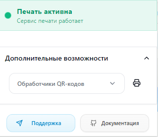

# 🌐 PrintNum Extension

Браузерное расширение для автоматизации работы сотрудников ПВЗ Ozon.

Расширение интегрируется с сайтом `turbo-pvz.ozon.ru`, взаимодействует с приложением PrintNum для печати ячеек, автоматизирует операции выдачи/оплаты заказов, приемки и упаковки возвратов с помощью QR-кодов, скрытие элементов на странице для работы только с необходимыми разделами сайта, автоскрипты для сокращения лишних действий на работе.

---

## 📋 Содержание

- [PrintNum Extension](#-printnum-extension)
- [Возможности](#возможности)
- [Требования](#требования)
- [Использование](#использование)
  - [Печать ячеек](#печать-ячеек)
  - [Печать Ozon полки](#печать-ozon-полки)
  - [QR-команды](#qr-команды)
  - [Настройки QR-команд](#настройки-qr-команд)
- [Внешний вид](#внешний-вид)
- [API взаимодействия](#api-взаимодействия)
- [Помощь](#помощь)

---

# Возможности

[(Вернуться к началу)](#-printnum-extension)

- Автоматическая отправка ячеек на печать.
- QR-команды для выдачи всех предоплаченных заказов, отдельного оплаченного/неоплаченного заказа с выбором нужного пакета или автоматический выбор пакета, переключение режима «С рекомендацией» и выбор упаковки для возвратов.
- Автоскрипты для сокращения лишних действий
- Скрытие и показ элементов для работы только с нужными разделами сайта
- Проверка доступности сервиса печати и переход к скачиванию актуальной версии PrintNum для Windows.

---

# Требования

[(Вернуться к началу)](#-printnum-extension)

- Chromium-браузер:
  - Google Chrome
  - Yandex Browser
  - Microsoft Edge

# Использование

## Печать ячеек

Раздел, где сработает скрипт:

```text
Приемка
```

или

```text
Выдача заказов
```

Выполняет следующие действия:

Скрипт работает в фоновом режиме, отслеживает изменения на странице через MutationObserver и отправляет номера ячеек на печать в зависимости от текущего раздела:

- В разделе «Приемка»:
  1. При первом открытии получает до 10 актуальных ячеек, сохраняет их для сравнения и ничего не печатает.
  2. При появлении новых данных сравнивает текущий список со старым. Если они отличаются, скрипт берет самый первый (новый) элемент, обновляет сохраненный список и отправляет этот элемент на печать.

- В разделе «Выдача заказов»:
  1. Скрипт следит за одной конкретной целевой ячейкой.
  2. При изменении её значения отправляет новый номер на печать, защищая от повторной отправки одного и того же номера.

  При любом переходе между разделами состояние и история проверок полностью сбрасываются.

## Печать ozon полки

Раздел, где сработает скрипт отправки на печать:

```text
Отправка - Ozon Полка - Перемещение товаров
```

Как работает:

1. Отслеживает текущую строку таблицы и сравнивает с последней отсканированной.
2. При отличии берёт значение из колонки «Новая ячейка» и отправляет на печать.
3. Исключает дубли по ID из «Текущая ячейка» — для одной и той же строки отправка происходит единоразово до её смены.

#### Повторная печать «Ozon Полка»

Если нужно повторно отправить ту же «Полку» на печать, выполните один из вариантов:

- Отсканируйте другой товар (сменится текущая строка), затем снова отсканируйте нужный товар; или
- Перейдите в раздел «Подготовка к отправке», после чего вернитесь в текущий раздел «Перемещение товаров» и ещё раз отсканируйте товар, который требуется повторно отправить.

После смены строки или перехода между разделами внутренняя отметка сбрасывается, и повторная отправка сработает.

## QR-команды

> ℹ️ Перед использованием QR-кодов их можно распечатать для удобства работы.

> ℹ️ Файл с QR-кодами можно найти через иконку расширения.

> ℹ️ Рекомендуется вырезать QR-коды и наклеить их в удобном месте. Пожалуйста, оставляйте между ними небольшое расстояние, чтобы случайно не отсканировать не тот код, так как у них разное назначение.

### Выдать заказ (без пакета / M / L)

Раздел, где сработает QR-код:

```text
Выдача заказов → Открытая карточка для выдачи
```

Выполняет следующие действия:

1. Для вариантов M и L выбирает соответствующий пакет.
2. Нажимает «Выдать».

Если нужная кнопка не найдена, сценарий прекращает выполнение после ожидания элемента.

---

### Выдать всё (без пакета / M / L)

> ℹ️ Данный скрипт работает только с оплаченными заказами.

> ℹ️ Если при запуске не удается найти какой либо элемент в течении 5сек он автоматически останавливается

Раздел, где сработает QR-код:

```text
Выдача заказов
```

Выполняет следующие действия:

1. Нажимает «К выдаче».
2. Для вариантов M и L выбирает соответствующий пакет.
3. Нажимает «Выдать».

Сценарий повторяет действия с паузой в одну секунду, пока они доступны, но не более 50 раз за один запуск.

---

### Оплатить заказ (без пакета / M / L)

Раздел, где сработает QR-код:

```text
Выдача заказов → Открытая карточка для выдачи
```

Выполняет следующие действия:

1. Для вариантов M и L выбирает соответствующий пакет.
2. Нажимает «Провести оплату».

Если оплата не прошла и появилась кнопка:

```text
Попробовать ещё
```

повторное сканирование QR-кода запустит сценарий оплаты ещё раз.

---

### Выдать все (авто)

> ℹ️ Данный скрипт работает только с оплаченными заказами.

> ℹ️ Если при запуске не удается найти какой либо элемент в течении 5сек он автоматически останавливается

> ℹ️ Выбор пакета автоматически синхронизируется с другими вкладками. Например: в первой вкладке был выбран сначала пакет М, то во второй вкладке будет выборан пакет L, в третьей без пакета и тд.

Раздел, где сработает QR-код:

```text
Выдача заказов
```

Выполняет следующие действия:

1. Нажимает «К выдаче».
2. Автоматически выбирает пакет по общему циклу с дополнительной синхронизацией с другими вкладками

```text
без пакета → M → L → без пакета → ...
```

3. Нажимает «Выдать».

Сценарий повторяет действия с паузой в одну секунду, пока они доступны, но не более 50 раз за один запуск.

---

### Выдать заказ (авто)

Раздел, где сработает QR-код:

```text
Выдача заказов → Открытая карточка для выдачи
```

Выполняет следующие действия:

1. Автоматически выбирает пакет по общему циклу с дополнительной синхронизацией с другими вкладками

```text
без пакета → M → L → без пакета → ...
```

2. Нажимает «Выдать».

Если нужная кнопка не найдена, сценарий прекращает выполнение после ожидания элемента.

---

### Оплатить заказ (авто)

Раздел, где сработает QR-код:

```text
Выдача заказов → Открытая карточка для выдачи
```

Выполняет следующие действия:

1. Автоматически выбирает пакет по общему циклу с дополнительной синхронизацией с другими вкладками

```text
без пакета → M → L → без пакета → ...
```

2. Нажимает «Провести оплату».

Если оплата не прошла и появилась кнопка:

```text
Попробовать ещё
```

повторное сканирование QR-кода запустит сценарий оплаты ещё раз.

---

### С рекомендацией

Раздел, где сработает QR-код:

```text
Приёмка
```

Выполняет следующие действия:
Автоматически переключает тумблер (флажок / режим)

```text
С рекомендацией
```

---

# Внешний вид

[(Вернуться к началу)](#-printnum-extension)

<table>
  <thead>
    <tr>
      <th>Светлая тема</th>
      <th>Тёмная тема</th>
    </tr>
  </thead>
  <tbody>
    <tr>
      <td></td>
      <td></td>
    </tr>
  </tbody>
</table>

---

# API взаимодействия

[(Вернуться к началу)](#-printnum-extension)

Базовый URL:

```text
http://127.0.0.1:5000
```

Для сетевых запросов расширению предоставлен доступ к `http://127.0.0.1/*`
(сервис печати) и `https://printnum.s3.cloud.ru/latest.json`
(получение ссылки на установщик). Доступ к `turbo-pvz.ozon.ru` задаётся
правилом `matches` у content scripts.

| Метод | Endpoint      | Назначение                          |
| ----- | ------------- | ----------------------------------- |
| GET   | /             | Проверка доступности сервиса печати |
| POST  | /print-number | Отправка номера ячейки для печати   |
| POST  | /ozon-shelf   | Отправка текста «Ozon Полка»        |

Пример:

```javascript
await fetch("http://127.0.0.1:5000/print-number", {
  method: "POST",
  headers: {
    "Content-Type": "application/json",
  },
  body: JSON.stringify({
    text: "123-456",
  }),
});
```

---

## Помощь

[(Вернуться к началу)](#-printnum-extension)

- **Telegram:** [@printnum](https://t.me/printnum) — официальный канал PrintNum, где можно получить помощь и следить за обновлениями.
