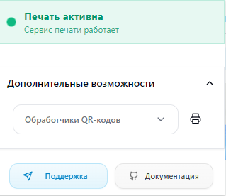
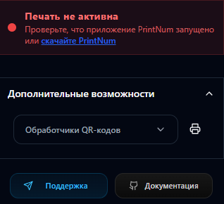

# 🌐 PrintNum Extension

> ℹ️ **В этой папке находится исходный код расширения с дополнительными функциями для опытных пользователей.** При ручной установке этой версии из исходников расширение **не будет обновляться автоматически**, в отличие от официальной версии из Chrome Web Store.

Браузерное расширение для автоматизации работы сотрудников ПВЗ Ozon.

Расширение интегрируется с сайтом `turbo-pvz.ozon.ru` и приложением PrintNum. Оно автоматизирует печать ячеек, работу с QR-командами, отдельные операции выдачи и оплаты заказов, приёмки и упаковки возвратов, а также позволяет управлять видимостью элементов сайта.

---

## 📋 Содержание

- [PrintNum Extension](#-printnum-extension)
- [Установка](#установка)
- [Возможности](#возможности)
- [Требования](#требования)
- [Использование](#использование)
  - [Печать ячеек](#печать-ячеек)
  - [Печать Ozon полки](#печать-ozon-полки)
  - [QR-команды](#qr-команды)
  - [Автоскрипты](#автоскрипты)
  - [Настройка видимости](#настройка-видимости)
- [Внешний вид](#внешний-вид)
- [API взаимодействия](#api-взаимодействия)
- [Помощь](#помощь)

---

## Установка

[(Вернуться к началу)](#-printnum-extension)

Для обычного использования рекомендуется установить [PrintNum из Chrome Web Store](https://chromewebstore.google.com/detail/printnum-%D0%BF%D0%B5%D1%87%D0%B0%D1%82%D1%8C-%D1%8F%D1%87%D0%B5%D0%B5%D0%BA-ozo/pebpcdibpeodhdkbeniijidffpfpiagn) или найти **«PrintNum - Печать Ячеек (Ozon)»** через поиск магазина. Эта версия получает обновления через Chrome Web Store.

Локальная установка исходников из этой папки предназначена для разработки и проверки изменений в ветке:

1. Скачайте архив с папкой расширения по [ссылке](https://downgit.github.io/#/home?url=https://github.com/kirill18734/PrintNum/tree/new-extension/extension).
2. Распакуйте архив в удобное место на компьютере.
3. Откройте страницу `chrome://extensions` в браузере.
4. Включите режим разработчика.
5. Нажмите **Загрузить распакованное расширение**.
6. Выберите распакованную папку `extension`.

Сборка не требуется: Chrome загружает файлы напрямую по путям и в порядке, указанным в `extension/manifest.json`.

После установки запустите локальный сервис PrintNum и откройте [turbo-pvz.ozon.ru](https://turbo-pvz.ozon.ru/).

### Структура расширения

- `src/content/shared/` — общие настройки, работа с хранилищем, DOM, API, навигацией и клавиатурой.
- `src/content/features/` — функции, работающие на страницах Ozon: QR-команды, автоскрипты, печать, управление видимостью и баннерами.
- `src/background/` — Background Service Worker, который принимает сообщения от content scripts и передаёт запросы локальному сервису.
- `src/popup/` — popup расширения: статус локального сервиса, загрузка приложения и настройки функций.
- `manifest.json` — разрешения, точка входа popup, service worker и порядок подключения content scripts.

### Режим PROD и DEV

Режим задаётся флагом `isDevMode` в `chrome.storage.local`.

- **PROD (по умолчанию при первой установке):** дополнительные разделы popup — «Автоскрипты», «Настройка видимости», «Меню», «Уведомления», «Возвраты» и «Баннеры» — скрыты. Соответствующие дополнительные функции страницы не запускаются.
- **DEV:** открывает дополнительные разделы popup и разрешает работу функций, управляемых этим режимом.
- Печать ячеек и QR-команды не зависят от переключателя DEV/PROD. При этом доступность каждой QR-команды отдельно определяется её настройкой включения/отключения.

При первой инициализации устанавливается `isDevMode = false`. У существующих пользователей сохранённое значение режима не перезаписывается.

При первом запуске баннеры включены, а все QR-команды и автоскрипты выключены. В дальнейшем расширение синхронизирует сохранённые списки с актуальной конфигурацией: удаляет устаревшие элементы и добавляет новые. Новые QR-команды и автоскрипты добавляются выключенными; новые баннеры — включёнными.

В popup также отображаются статус локального сервиса и кнопка загрузки приложения. Проверка сервиса выполняется запросом к локальному адресу, а ссылка на установщик загружается из `latest.json`. Эти действия не зависят от режима DEV/PROD.

---

## Возможности

[(Вернуться к началу)](#-printnum-extension)

- Проверка доступности локального сервиса печати и загрузка актуального установщика PrintNum для Windows.
- Автоматическая отправка ячеек на печать.
- QR-команды для выдачи и оплаты заказов, выбора упаковки и переключения режима «С рекомендацией».
- Автоматический выбор пакета по общему циклу для соответствующих QR-команд.
- Автоскрипты для сокращения повторяющихся действий.
- Управление видимостью элементов сайта и рекламных баннеров.

---

## Требования

[(Вернуться к началу)](#-printnum-extension)

- Chromium-браузер:
  - Google Chrome
  - Yandex Browser
  - Microsoft Edge
- Запущенный локальный сервис PrintNum — для отправки данных на печать.
- Доступ к сайту `https://turbo-pvz.ozon.ru/`.

---

## Печать ячеек

Разделы, где работает скрипт:

```text
Приемка
Выдача заказов
```

Скрипт работает в фоновом режиме, отслеживает изменения на странице через MutationObserver и отправляет номера ячеек на печать в зависимости от текущего раздела.

- **В разделе «Приемка»:**
  1. При первом открытии получает до 10 актуальных ячеек, сохраняет их для сравнения и ничего не печатает.
  2. При появлении новых данных сравнивает текущий список с предыдущим. Если список изменился, берёт первый новый элемент, обновляет сохранённый список и отправляет этот элемент на печать.

- **В разделе «Выдача заказов»:**
  1. Следит за целевой ячейкой.
  2. При изменении её значения отправляет новый номер на печать, защищая от повторной отправки того же значения.
  3. После отправки ячейки запускает сценарий нажатия кнопки «Подтвердить размещение» (если он разрешён текущим режимом и включён в настройках).

При переходе между разделами состояние и история проверок сбрасываются.

---

## Печать Ozon полки

[(Вернуться к началу)](#-printnum-extension)

Раздел, где работает скрипт:

```text
Отправка → Ozon Полка → Перемещение товаров
```

Как работает:

1. Отслеживает текущую строку таблицы и сравнивает её с последней отсканированной.
2. При изменении строки берёт значение из колонки «Новая ячейка» и отправляет его на печать.
3. Исключает повторную отправку по ID из колонки «Текущая ячейка»: для одной и той же строки отправка выполняется один раз до смены строки.

### Повторная печать «Ozon Полка»

Если нужно повторно отправить ту же «Полку» на печать:

- Отсканируйте другой товар, чтобы сменилась текущая строка, а затем снова отсканируйте нужный товар.
- Либо перейдите в раздел «Подготовка к отправке», вернитесь в «Перемещение товаров» и повторно отсканируйте нужный товар.

После смены строки или перехода между разделами внутренняя отметка сбрасывается.

---

## QR-команды

[(Вернуться к началу)](#-printnum-extension)

> ℹ️ Перед использованием QR-коды можно распечатать: PDF с ними доступен по кнопке с иконкой принтера в popup расширения.

> ℹ️ Рекомендуется вырезать QR-коды и наклеить их в удобном месте. Оставляйте между ними небольшое расстояние, чтобы случайно не отсканировать соседний код.

Названия ниже соответствуют названиям команд в конфигурации расширения.

### Выдать заказ

Раздел:

```text
Выдача заказов → Открытая карточка для выдачи
```

Доступные варианты:

- **Выдать заказ (без пакета)** — нажимает «Выдать».
- **Выдать заказ (+1 пакет M)** — выбирает пакет M и нажимает «Выдать».
- **Выдать заказ (+1 пакет L)** — выбирает пакет L и нажимает «Выдать».

Если нужная кнопка не найдена, сценарий прекращает выполнение.

### Выдать все

> ℹ️ Команды этой группы работают только с оплаченными заказами.

Раздел:

```text
Выдача заказов
```

Доступные варианты:

- **Выдать все (без пакета)**
- **Выдать все (+1 пакет M)**
- **Выдать все (+1 пакет L)**

Сценарий нажимает «К выдаче», при необходимости выбирает пакет, затем нажимает «Выдать». Действия повторяются с паузой в одну секунду, пока они доступны, но не более 50 раз за один запуск. Если нужный элемент не удаётся найти в течение 5 секунд, сценарий останавливается.

### Оплатить заказ

Раздел:

```text
Выдача заказов → Открытая карточка для выдачи
```

Доступные варианты:

- **Оплатить заказ (без пакета)**
- **Оплатить заказ (+1 пакет M)**
- **Оплатить заказ (+1 пакет L)**

Для вариантов M и L сначала выбирается соответствующий пакет, затем нажимается «Провести оплату».

Если оплата не прошла и появилась кнопка «Попробовать ещё», повторное сканирование QR-кода запустит сценарий оплаты ещё раз.

### Автоматический выбор пакета

Для следующих QR-команд пакет выбирается автоматически по общему циклу:

```text
без пакета → M → L → без пакета → ...
```

Выбор синхронизируется между вкладками: следующая вкладка продолжает общий цикл, а не начинает его заново.

- **Выдать все (авто)** — раздел «Выдача заказов». Нажимает «К выдаче», выбирает пакет по циклу и нажимает «Выдать». Повторяет действия не более 50 раз за один запуск.
- **Выдать заказ (авто)** — открытая карточка выдачи. Выбирает пакет по циклу и нажимает «Выдать».
- **Оплатить заказ (авто)** — открытая карточка выдачи. Выбирает пакет по циклу и нажимает «Провести оплату».

Для команд, работающих с открытой карточкой, если нужный элемент не найден, сценарий прекращает выполнение после ожидания элемента.

### Автосценарий

Объединяет логику команд «Выдать все (авто)», «Выдать заказ (авто)» и «Оплатить заказ (авто)».

Работает в разделах:

```text
Выдача заказов
Выдача заказов → Открытая карточка для выдачи
```

- В списке заказов запускает сценарий «Выдать все (авто)».
- В открытой карточке запускает «Выдать заказ (авто)» или «Оплатить заказ (авто)» в зависимости от доступного действия.

### С рекомендацией

Раздел:

```text
Приёмка
```

Переключает тумблер «С рекомендацией».

### Выбор упаковки

Раздел:

```text
Отправка
```

QR-команда выбирает соответствующую радиокнопку. Доступны:

1. Сейф-пакет XS
2. Сейф-пакет S
3. Сейф-пакет M
4. Сейф-пакет L
5. Сейф-пакет XL
6. Упаковки Ozon нет в наличии
7. Товар слишком большой

---

## Автоскрипты

[(Вернуться к началу)](#-printnum-extension)

Автоскрипты доступны в DEV-режиме и дополнительно включаются или отключаются по отдельности в popup.

### Упаковки Ozon нет в наличии

Раздел:

```text
Отправка → Отправка перевозок → Прямой/Возвратный поток
```

Когда на странице появляется вариант «Упаковки Ozon нет в наличии», скрипт находит его радиокнопку и выбирает её, если она ещё не выбрана. Сканирование штрихкодов пользователь выполняет самостоятельно.

### Перенести тарники в перевозку

Раздел:

```text
Отправка → Отправка перевозок → Прямой/Возвратный поток
```

Когда блок начинается с текста «Добавьте содержимое в перевозку», скрипт отмечает позиции, содержащие «КТЯ», и нажимает «Переместить». Если список, чекбоксы или кнопка отсутствуют, действие не выполняется.

### Подтверждение выдачи (2x Enter)

Раздел:

```text
Выдача заказов → Открытая карточка для выдачи
```

Если на странице открытой карточки появляется кнопка «Подтвердить», её можно нажать двойным нажатием **Enter**. На других страницах сочетание не срабатывает.

### Автоподтверждение размещения

Раздел:

```text
Выдача заказов → Открытая карточка для выдачи
```

После отправки новой ячейки, если появляется кнопка «Подтвердить размещение», скрипт автоматически нажимает её. Функция выполняется только в DEV-режиме и при включённом автоскрипте.

---

## Настройка видимости

[(Вернуться к началу)](#-printnum-extension)

Настройки доступны в DEV-режиме. Изменения применяются сразу или при переходе на другую страницу.

### Меню

Работает на всех страницах. Позволяет скрывать отдельные элементы бокового меню.

### Уведомления

Позволяет скрывать всплывающие уведомления в правом верхнем углу на поддерживаемых страницах.

### Возвраты

Раздел:

```text
Отправка → Отправка перевозок → Прямой/Возвратный поток
```

Позволяет скрывать отдельные возвраты из списка.

В popup отображаются общее количество элементов, а также количество включённых и выключенных. Счётчики считают элементы списка, а не уникальные названия: одинаково названные возвраты учитываются отдельно. Если название присутствует в списке выключенных, все возвраты с таким названием считаются выключенными.

### Баннеры

В popup доступны отдельные настройки для двух баннеров:

- **Баннер (Выдача заказов)** — скрывает рекламный баннер в списке заказов.
- **Баннер (Открытая карточка выдачи)** — скрывает баннер в открытой карточке заказа.

Состояние переключателей сохраняется в `chrome.storage.local`. Новые QR-команды и автоскрипты после обновления расширения добавляются выключенными.

---

## Внешний вид

[(Вернуться к началу)](#-printnum-extension)

<table>
  <thead>
    <tr>
      <th>Светлая тема</th>
      <th>Тёмная тема</th>
    </tr>
  </thead>
  <tbody>
    <tr>
      <td></td>
      <td></td>
    </tr>
  </tbody>
</table>

---

## API взаимодействия

[(Вернуться к началу)](#-printnum-extension)

Базовый адрес локального сервиса:

```text
http://127.0.0.1:5000
```

Расширению разрешены сетевые запросы к:

- `http://127.0.0.1/*` — локальный сервис PrintNum.
- `https://printnum.s3.cloud.ru/*` — получение манифеста актуальной версии приложения.

Доступ к `turbo-pvz.ozon.ru` задаётся правилом `matches` в `manifest.json` для content scripts.

### Поток запросов на печать

1. Content scripts отслеживают изменения на странице Ozon и формируют данные для печати.
2. Через `chrome.runtime.sendMessage` они передают сообщение Background Service Worker.
3. Service Worker отправляет POST-запрос локальному сервису.
4. Popup независимо проверяет доступность сервиса GET-запросом к `/` и получает ссылку на установщик из `latest.json`.

| Метод | Endpoint        | Назначение                          |
| ----- | --------------- | ----------------------------------- |
| GET   | `/`             | Проверка доступности сервиса печати |
| POST  | `/print-number` | Отправка номера ячейки для печати   |
| POST  | `/ozon-shelf`   | Отправка текста «Ozon Полка»        |

Пример POST-запроса, который Background Service Worker отправляет локальному сервису:

```javascript
await fetch("http://127.0.0.1:5000/print-number", {
  method: "POST",
  headers: {
    "Content-Type": "application/json",
  },
  body: JSON.stringify({
    text: "123-456",
  }),
});
```

---

## Помощь

[(Вернуться к началу)](#-printnum-extension)

- **Telegram:** [@printnum](https://t.me/printnum) — официальный канал PrintNum, где можно получить помощь и следить за обновлениями.
