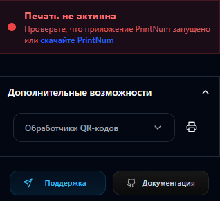

# 🌐 PrintNum Extension

Браузерное расширение для автоматизации работы сотрудников ПВЗ Ozon.

Расширение интегрируется с сайтом `turbo-pvz.ozon.ru`, взаимодействует с приложением PrintNum для печати ячеек, автоматизирует операции выдачи/оплаты заказов, приемки и упаковки возвратов с помощью QR-кодов, скрытие элементов на странице для работы только с необходимыми разделами сайта, автоскрипты для сокращения лишних действий на работе.

---

## 📋 Содержание

- [PrintNum Extension](#-printnum-extension)
- [Возможности](#возможности)
- [Установка](#установка)
- [Требования](#требования)
- [Использование](#использование)
  - [Печать ячеек](#печать-ячеек)
  - [Печать Ozon полки](#печать-ozon-полки)
  - [QR-команды](#qr-команды)
  - [Автоскрипты](#автоскрипты)
  - [Настройка видимости](#автоскрипты)
- [Внешний вид](#внешний-вид)
- [API взаимодействия](#api-взаимодействия)
- [Помощь](#помощь)

---

# Возможности

[(Вернуться к началу)](#-printnum-extension)

- Проверка доступности сервиса печати и переход к скачиванию актуальной версии PrintNum для Windows.
- Автоматическая отправка ячеек на печать.
- QR-команды для выдачи всех предоплаченных заказов, отдельного оплаченного/неоплаченного заказа с выбором нужного пакета или автоматический выбор пакета, переключение режима «С рекомендацией» и выбор упаковки для возвратов.
- Автоскрипты для сокращения лишних действий
- Скрытие и показ элементов на сайте

---

# Установка

[(Вернуться к началу)](#-printnum-extension)

Расширение не обязательно устанавливать из локальной папки. Откройте страницу в [Chrome Web Store](https://chromewebstore.google.com/detail/printnum-%D0%BF%D0%B5%D1%87%D0%B0%D1%82%D1%8C-%D1%8F%D1%87%D0%B5%D0%B5%D0%BA-ozo/pebpcdibpeodhdkbeniijidffpfpiagn) или найдите **«PrintNum - Печать Ячеек (Ozon)»** через поиск магазина. Нажмите **Установить** и подтвердите установку.

Локальная установка требуется только для разработки или проверки изменений в этой ветке:

1. Откройте `chrome://extensions`.
2. Включите режим разработчика.
3. Нажмите **Загрузить распакованное расширение**.
4. Выберите каталог `extension` в склонированном проекте.

Сборка расширения не требуется: Chrome загружает файлы напрямую по путям и в порядке, указанным в `extension/manifest.json`. Общие сервисы и конфигурация находятся в `extension/src/content/shared/`, функции страницы — в `extension/src/content/features/`, service worker и popup — в отдельных каталогах `extension/src/background/` и `extension/src/popup/`.

После любого способа установки запустите сервис печати и откройте `https://turbo-pvz.ozon.ru/`.

В popup расширения отображается статус локального сервиса и ссылка на загрузку приложения. Проверка локального сервиса и получение ссылки выполняются независимо от настроек popup: если API недоступен, разделы QR-команд, автоскриптов и настройка видимости продолжают работать.

# Требования

[(Вернуться к началу)](#-printnum-extension)

- Chromium-браузер:
  - Google Chrome
  - Yandex Browser
  - Microsoft Edge

# Использование

[(Вернуться к началу)](#-printnum-extension)

## Печать ячеек

Раздел, где сработает скрипт:

```text
Приемка
```

или

```text
Выдача заказов
```

Выполняет следующие действия:

Скрипт работает в фоновом режиме, отслеживает изменения на странице через MutationObserver и отправляет номера ячеек на печать в зависимости от текущего раздела:

- В разделе «Приемка»:
  1. При первом открытии получает до 10 актуальных ячеек, сохраняет их для сравнения и ничего не печатает.
  2. При появлении новых данных сравнивает текущий список со старым. Если они отличаются, скрипт берет самый первый (новый) элемент, обновляет сохраненный список и отправляет этот элемент на печать.

- В разделе «Выдача заказов»:
  1. Скрипт следит за одной конкретной целевой ячейкой.
  2. При изменении её значения отправляет новый номер на печать, защищая от повторной отправки одного и того же номера.

  При любом переходе между разделами состояние и история проверок полностью сбрасываются.

## Печать ozon полки

[(Вернуться к началу)](#-printnum-extension)

Раздел, где сработает скрипт отправки на печать:

```text
Отправка - Ozon Полка - Перемещение товаров
```

Как работает:

1. Отслеживает текущую строку таблицы и сравнивает с последней отсканированной.
2. При отличии берёт значение из колонки «Новая ячейка» и отправляет на печать.
3. Исключает дубли по ID из «Текущая ячейка» — для одной и той же строки отправка происходит единоразово до её смены.

#### Повторная печать «Ozon Полка»

Если нужно повторно отправить ту же «Полку» на печать, выполните один из вариантов:

- Отсканируйте другой товар (сменится текущая строка), затем снова отсканируйте нужный товар;
- Перейдите в раздел «Подготовка к отправке», после чего вернитесь в текущий раздел «Перемещение товаров» и ещё раз отсканируйте товар, который требуется повторно отправить.

После смены строки или перехода между разделами внутренняя отметка сбрасывается, и повторная отправка сработает.

## QR-команды

[(Вернуться к началу)](#-printnum-extension)

> ℹ️ Перед использованием QR-кодов их можно распечатать для удобства работы. Файл с QR-кодами можно найти через иконку расширения

> ℹ️ Рекомендуется вырезать QR-коды и наклеить их в удобном месте. Пожалуйста, оставляйте между ними небольшое расстояние, чтобы случайно не отсканировать не тот qr-код, так как у них разное назначение.

### Выдать заказ (без пакета / M / L)

Раздел, где сработает QR-код:

```text
Выдача заказов → Открытая карточка для выдачи
```

Выполняет следующие действия:

1. Для вариантов M и L выбирает соответствующий пакет.
2. Нажимает «Выдать».

Если нужная кнопка не найдена, сценарий прекращает выполнение.

---

### Выдать всё (без пакета / M / L)

> ℹ️ Данный скрипт работает только с оплаченными заказами.

> ℹ️ Если при запуске не удается найти какой либо элемент в течении 5сек он автоматически останавливается.

Раздел, где сработает QR-код:

```text
Выдача заказов
```

Выполняет следующие действия:

1. Нажимает «К выдаче».
2. Для вариантов M и L выбирает соответствующий пакет.
3. Нажимает «Выдать».

Сценарий повторяет действия с паузой в одну секунду, пока они доступны, но не более 50 раз за один запуск.

---

### Оплатить заказ (без пакета / M / L)

Раздел, где сработает QR-код:

```text
Выдача заказов → Открытая карточка для выдачи
```

Выполняет следующие действия:

1. Для вариантов M и L выбирает соответствующий пакет.
2. Нажимает «Провести оплату».

Если оплата не прошла и появилась кнопка:

```text
Попробовать ещё
```

повторное сканирование QR-кода запустит сценарий оплаты ещё раз.

---

### Выдать все (авто)

> ℹ️ Данный скрипт работает только с оплаченными заказами.

> ℹ️ Если при запуске не удается найти какой либо элемент в течении 5сек он автоматически останавливается

> ℹ️ Выбор пакета автоматически синхронизируется с другими вкладками. Например: в первой вкладке был выбран сначала пакет М, то во второй вкладке будет выборан пакет L, в третьей без пакета и тд.

Раздел, где сработает QR-код:

```text
Выдача заказов
```

Выполняет следующие действия:

1. Нажимает «К выдаче».
2. Автоматически выбирает пакет по общему циклу с дополнительной синхронизацией с другими вкладками

```text
без пакета → M → L → без пакета → ...
```

3. Нажимает «Выдать».

Сценарий повторяет действия с паузой в одну секунду, пока они доступны, но не более 50 раз за один запуск.

---

### Выдать заказ (авто)

> ℹ️ Выбор пакета автоматически синхронизируется с другими вкладками. Например: в первой вкладке был выбран сначала пакет М, то во второй вкладке будет выборан пакет L, в третьей без пакета и тд.

Раздел, где сработает QR-код:

```text
Выдача заказов → Открытая карточка для выдачи
```

Выполняет следующие действия:

1. Автоматически выбирает пакет по общему циклу с дополнительной синхронизацией с другими вкладками

```text
без пакета → M → L → без пакета → ...
```

2. Нажимает «Выдать».

Если нужная кнопка не найдена, сценарий прекращает выполнение после ожидания элемента.

---

### Оплатить заказ (авто)

> ℹ️ Выбор пакета автоматически синхронизируется с другими вкладками. Например: в первой вкладке был выбран сначала пакет М, то во второй вкладке будет выборан пакет L, в третьей без пакета и тд.

Раздел, где сработает QR-код:

```text
Выдача заказов → Открытая карточка для выдачи
```

Выполняет следующие действия:

1. Автоматически выбирает пакет по общему циклу с дополнительной синхронизацией с другими вкладками

```text
без пакета → M → L → без пакета → ...
```

2. Нажимает «Провести оплату».

Если оплата не прошла и появилась кнопка:

```text
Попробовать ещё
```

повторное сканирование QR-кода запустит сценарий оплаты ещё раз.

---

### Автосценарий

> ℹ️ Данный qr-код объединяет в себе работу нескольких qr-кодов: Выдать все (авто), Выдать заказ (авто), Оплатить заказ (авто).

> ℹ️ Выбор пакета автоматически синхронизируется с другими вкладками. Например: в первой вкладке был выбран сначала пакет М, то во второй вкладке будет выборан пакет L, в третьей без пакета и тд.

Раздел, где сработает QR-код:

```text
Выдача заказов
```

или

```text
Выдача заказов → Открытая карточка для выдачи
```

Выполняет следующие действия:

1. Если вы находитесь в разделе `Выдача заказов`, при сканировании активируется qr-код `Выдать все (авто)`, подр. см [Выдать все (авто)](<###Выдать-все-(авто)>)
2. Если вы находитесь в разделе `Выдача заказов → Открытая карточка для выдачи`, при сканировании активируется qr-код [Выдать заказ (авто)](<###Выдать-заказ-(авто)>) или [Оплатить заказ (авто)](<###Оплатить-заказ-(авто)>)

### С рекомендацией

Раздел, где сработает QR-код:

```text
Приёмка
```

Выполняет следующие действия:

1. Переключает тумблер `С рекомендацией`.

### Выбор упаковки (радиокнопки)

Раздел, где сработает QR-код:

```text
Отправка
```

Как работает:

    После сканирования QR-кода расширение находит соответствующую радиокнопку и включает её. Доступные QR-команды:

      1. «Сейф-пакет XS»
      2. «Сейф-пакет S»
      3. «Сейф-пакет M»
      4. «Сейф-пакет L»
      5. «Сейф-пакет XL»
      6. «Упаковки Ozon нет в наличии»
      7. «Товар слишком большой»

## Автоскрипты

### Упаковки Ozon нет в наличии

Раздел, где сработает QR-код:

```text
Отправка → Отправка перевозок → Прямой/Возвратный поток
```

Как работает:

Когда на странице появляется вариант «Упаковки Ozon нет в наличии», скрипт находит его радиокнопку и выбирает её, если она ещё не выбрана. На этом автоматизация заканчивается: сканирование штрихкодов пользователь выполняет самостоятельно.

### Перенести тарники в перевозку

```text
Отправка → Отправка перевозок → Прямой/Возвратный поток
```

Как работает:

Скрипт работает, когда блок начинается с текста «Добавьте содержимое в перевозку». Он отмечает только позиции, содержащие «КТЯ», затем нажимает «Переместить». Если список, чекбоксы или кнопка отсутствуют, действие не выполняется.

### Настройки видимости

### Меню

Работает на всех страницах. Настройка применяется сразу или при переходе на другую страницу и позволяет скрыть отдельные элементы бокового меню.

### Уведомления

Для отдельных разделов позволяет скрывать всплывающие уведомления в правом верхнем углу. Настройка применяется сразу или при переходе на другую страницу.

### Возвраты

Раздел, где работает скрытие:

```text
Отправка → Отправка перевозок → Прямой/Возвратный поток
```

Позволяет скрыть определённые возвраты из списка.

При открытии раздела popup показывает общее количество возвратов и количества включённых и выключенных. Счётчики считают элементы списка, а не уникальные названия: одинаково названные возвраты учитываются отдельно. Если название присутствует в списке выключенных, все возвраты с таким названием считаются выключенными.

### Баннеры

В popup доступны отдельные настройки для двух баннеров. Настройки применяются сразу или при переходе на другую страницу.

#### Баннер (Выдача заказов)

Раздел, где работает скрытие:

```text
Выдача заказов
```

Скрывает рекламный баннер в списке заказов.

### Баннер (Открытая карточка выдачи)

Раздел, где работает скрытие:

```text
Выдача заказов → Открытая карточка для выдачи
```

Скрывает баннер в открытой карточке заказа.

Состояние переключателей сохраняется в `chrome.storage.local`. Новые QR-команды и автоскрипты после обновления расширения добавляются выключенными.

---

# Внешний вид

[(Вернуться к началу)](#-printnum-extension)

<table>
  <thead>
    <tr>
      <th>Светлая тема</th>
      <th>Тёмная тема</th>
    </tr>
  </thead>
  <tbody>
    <tr>
      <td></td>
      <td></td>
    </tr>
  </tbody>
</table>

---

# API взаимодействия

[(Вернуться к началу)](#-printnum-extension)

Базовый URL:

```text
http://127.0.0.1:5000
```

Для сетевых запросов расширению предоставлен доступ к `http://127.0.0.1/*`
(сервис печати) и `https://printnum.s3.cloud.ru/latest.json`
(получение ссылки на установщик). Доступ к `turbo-pvz.ozon.ru` задаётся
правилом `matches` у content scripts.

| Метод | Endpoint      | Назначение                          |
| ----- | ------------- | ----------------------------------- |
| GET   | /             | Проверка доступности сервиса печати |
| POST  | /print-number | Отправка номера ячейки для печати   |
| POST  | /ozon-shelf   | Отправка текста «Ozon Полка»        |

Пример:

```javascript
await fetch("http://127.0.0.1:5000/print-number", {
  method: "POST",
  headers: {
    "Content-Type": "application/json",
  },
  body: JSON.stringify({
    text: "123-456",
  }),
});
```

---

## Помощь

[(Вернуться к началу)](#-printnum-extension)

- **Telegram:** [@printnum](https://t.me/printnum) — официальный канал PrintNum, где можно получить помощь и следить за обновлениями.
